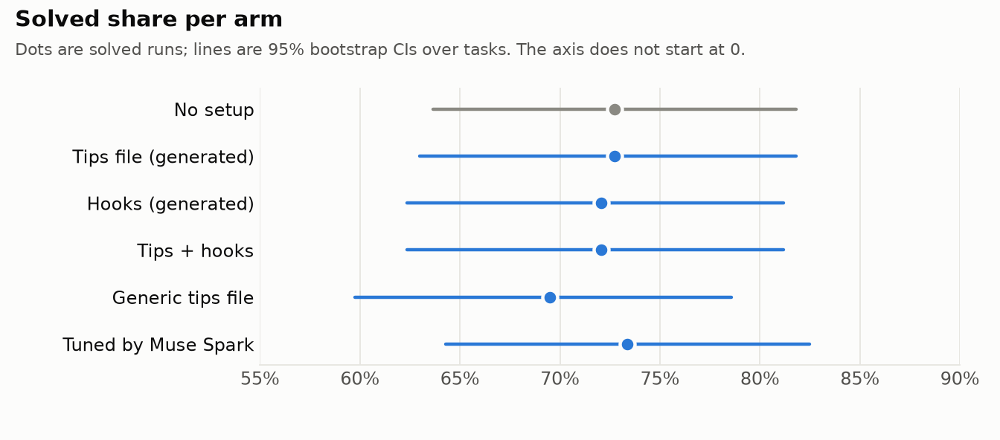

# Uplift

**Track:** Indie Developer · **Theme:** Push the Frontier
**Meta models used:** Muse Code is the agent under test. Muse Spark screens tasks, writes and tunes the setups, and labels failed runs. No other models are called at runtime.
**Built:** Oct 27 – Nov 4, 2026, during the Meta Global AI Developer Hackathon. The git history is unsquashed. [PHASE_LOG.md](PHASE_LOG.md) is the engineering journal.

---

## The question

Teams pay for coding agents and then add setups to them: an `AGENTS.md`, hooks, lint and test
checks. Nobody measures whether a setup helps. **Uplift checks this on your own repo:** it replays
the repo's past bugs as test-graded tasks and runs the agent with and without each setup.

## Headline result

**On 77 real sqlglot bugs, no setup measurably helped Muse Code.** That covers a generated tips
file, generated hooks, both together, a generic best-practice `AGENTS.md`, and a setup tuned by Muse Spark.
924 agent runs (77 tasks × 6 arms × 2 repeats) were graded by the repo's own tests, for $21.31
($0.023 per run).



Paired difference against "no setup", task-level bootstrap (10,000 resamples, seed 20261101):

| Arm | Solved | Diff vs none (points) | 95% CI | Detectable at 80% power |
| --- | --- | --- | --- | --- |
| No setup | 112/154 (72.7%) | — | — | — |
| Tips file (generated) | 112/154 (72.7%) | +0.0 | −5.8 to +4.5 | 7.4 |
| Hooks (generated) | 111/154 (72.1%) | −0.6 | −6.5 to +4.5 | 8.0 |
| Tips + hooks | 111/154 (72.1%) | −0.6 | −7.1 to +5.8 | 9.1 |
| Generic tips file | 107/154 (69.5%) | −3.2 | −9.1 to +1.3 | 7.5 |
| Tuned by Muse Spark | 113/154 (73.4%) | +0.6 | −2.6 to +4.5 | 5.4 |

- **Every interval crosses zero.** The study could reliably detect a difference of 5–9 points.
  Smaller real effects can't be ruled out.
- **The generic file did worst:** lowest solve rate, highest cost per solved bug ($0.034 vs
  $0.031), and the most runs that broke other tests (2). This is a generic best-practice file,
  written by us in the style commonly shared online
  ([arms/handwritten/AGENTS.md](arms/handwritten/AGENTS.md)). Generic advice did not help.
- **Most tasks can't separate the arms.** 43 of 77 tasks were solved in every run of every arm,
  and 11 in none, so only 23 tasks can show a difference. A strong agent leaves a ceiling.

Full report with cost, failure labels, hook delivery and the dev ablation:
[reports/main.md](reports/main.md).

## Worked example: one bug, twelve runs

**Task** `tobymao__sqlglot-fresh-63296846`: a fresh bug, fixed upstream in May 2026. The web
audit found no exposure in any of its 12 runs.

**The bug.** sqlglot can't parse `SELECT 1 WINDOW a AS (PARTITION BY x)`. `WINDOW` can also be a
column alias, so the parser reads `1 WINDOW` as "1 aliased as window" and then trips over
`a AS (...)`.

**What the agents did.** Two approaches appeared across the six arms:

| Approach | Runs | Solved |
| --- | --- | --- |
| Shortcut: never treat `WINDOW` as an alias (a one-line change) | 7 | 0 |
| Look ahead: skip the alias only when `WINDOW <name> AS (` follows | 4 | 4 |
| Other (treat `WINDOW` like the ambiguous `LIMIT`/`OFFSET`) | 1 | 0 |

The shortcut fixes the query from the issue, in all six dialects the real test checks. But the
same test also checks that `window` still works as a plain alias, and there the shortcut breaks
the SQL: `SELECT col window FROM t` comes back as `SELECT col WINDOW FROM AS t`. Every shortcut
run failed on that line. The look-ahead fix keeps both, and it has the same shape as the real
upstream fix.

**By arm:** no setup 0/2, tips file 0/2, hooks 0/2, tips + hooks **2/2**, generic file 1/2,
tuned 1/2.

**Did the setup cause the 2/2?** Probably not. Both "tips + hooks" runs got the same co-change
warning as the two failed "hooks" runs (one also got a formatting note):

> co-change: you edited sqlglot/parser.py but not sqlglot/generator.py. New AST shape needs
> generator support or transpilation will regress.

That warning says nothing about aliases, and the tips file alone went 0/2. On this task the
outcome depends on which approach the agent happens to try first. That is why Uplift runs
repeats and judges arms only on paired, task-level intervals, never on one task.

**See the runs:** the task is entry 50 of `tasks` in
[site/data/results.json](site/data/results.json), with each run's diff and the hook messages it
received:

```bash
jq '.tasks[] | select(.id == "tobymao__sqlglot-fresh-63296846") | .results.both.runs[0]' site/data/results.json
```

## How it works

Uplift treats the repo's past bugs as an exam. The agent never sees the answer key, and it may
only study material from before the exam was written.

```
  repo's past bug fixes ──► EXAM QUESTIONS   bug-fix tasks: tests fail before the fix, pass after
            │                                (SWE-rebench tasks + fresh 2026 bugs mined from commits)
            ▼
  Muse Spark screens ─────► FAIR QUESTIONS   drop required tests the issue never describes
            │
            ▼
  date split ─────────────► PRACTICE vs FINAL  older = dev (practice), newest = test (final exam)
            │                                  leakage check: no final-exam fix in the study snapshot
            ▼
  Muse Spark writes ──────► STUDY NOTES      tips file + hooks, built only from pre-exam history
  the setup                                  (risk map: fix hot spots, churn, co-change rules)
            │
            ▼
  Muse Code sits ─────────► SIT THE EXAM     each arm, each task, clean workspace, no git history
  the exam                                   every run metered by a hard-capped budget proxy
            │
            ▼
  real tests grade ───────► ANSWER KEY       FAIL_TO_PASS must pass, PASS_TO_PASS must still pass
            │                                fail-closed: unparseable or mismatched output = fail
            ▼
  Muse Spark diagnoses ───► REVIEW + RETAKE  label failures, tune the setup on dev only,
                                             report paired differences with intervals
```

## Why you can trust the numbers

- **Leakage checks, with positive controls.** 0 of 40 test-set fixes and 0 of 40 fresh fixes are
  in the snapshots the setups learned from. The same check does fire when it should: at HEAD it
  finds 24 of 40 dev fixes and 30 of 40 fresh fixes.
- **Fresh 2026 bugs.** Half the tasks are sqlglot bugs fixed between April and October 2026, mined
  from the repo itself, so they are newer than the public benchmark tasks.
- **Muse Spark task screening.** 23 of 80 SWE-rebench sqlglot tasks (29%) had at least one required
  test that Muse Spark judged unrelated to the issue (several commits bundled into one task). An
  agent can't be expected to pass those tests from the issue alone. 38 of 164 FAIL_TO_PASS tests
  were left out and 4 tasks dropped. The rule was fixed before any arm results were seen, with no
  overrides. A spot-check of 10 judgements (by our coding assistant, not yet by hand) agreed on 9.
- **A grader that fails closed.** Only the repo's real tests decide, with test files reset first.
  Parsed counts must match pytest's own summary line, or the run can't pass. This caught three
  ways a failure can hide: stale bytecode, pytest `SUBFAILED` sub-tests read as passes, and
  keyword-labelled sub-tests.
- **Clean workspaces.** Each run starts from one snapshot with no git history. sqlglot's own
  `CLAUDE.md` and `AGENTS.md` are removed, so "no setup" really means none.
- **Dev and test kept apart.** Setups are tuned on dev tasks only. The code refuses any test or
  fresh task among the tuning inputs.
- **Web-leak audit, found and measured by us.** The workspaces had no history, but Muse Code still
  had web tools and shell network access. `uplift web-audit` read every tool call in every trace.
  80 of 924 runs (8.7%, a lower bound) reached the task's own fix or newer upstream code, 12–16 per
  arm. **The result holds without them.** Drop the 26 affected tasks, or count every exposed run as
  failed, and every interval still crosses zero. Uplift now blocks agent network access except to
  the model API, confirmed with a probe run. The 924 runs predate the block and are reported with
  the audit.
- **Every run metered.** All runs went through a hard-capped proxy that allows only Meta models.
  Its ledger total matches the sum of the per-run costs.

## What we built vs what we used

**Built during the hackathon (this repo):**

- Budget guard: a spend-capped proxy that allows only Meta models, plus a guarded Muse runner that
  reserves each run's worst-case cost before it starts (`tools/budget_guard/`).
- Task loader, date split and snapshot leakage checks, with positive controls.
- Fresh-task miner: recent fix commits that link a GitHub issue.
- Validator: proves each task fails before the fix and passes after, repeated.
- Muse Spark task screening.
- Fail-closed grader.
- Risk map from git history: fix frequency, churn, SZZ bug-introducers, co-change rules.
- Setup generator (Muse Spark), the arms, and their hooks. This includes the generic arm's
  `AGENTS.md`: a generic best-practice file, written by us in the style commonly shared online.
- Paid batch runner.
- Muse Spark tuning and failure labelling.
- Web-leak audit and agent network block.
- Analysis, report and charts. `site/data/results.json` is the data export for the results page.
- Results website (frontend): built by Aryan Kansal.

**Used, not built by us:**

| What | Role | Licence |
| --- | --- | --- |
| Muse Code (Meta) | The coding agent under test | Meta API terms |
| Muse Spark (Meta) | Screening, setup generation, tuning, failure labels | Meta API terms |
| [sqlglot](https://github.com/tobymao/sqlglot) | The repository whose bugs we replay | MIT |
| [SWE-rebench](https://huggingface.co/datasets/nebius/SWE-rebench) | Pre-validated sqlglot tasks | CC-BY-4.0 |
| pyarrow, matplotlib, pytest | Data loading, charts, tests | Apache-2.0, PSF-based, MIT |

Details and citations: [NOTICE.md](NOTICE.md).

## Reproduce the numbers

Every number in this README and in `reports/main.md` comes from saved run results. Regenerating
them makes **no model calls**:

```bash
uv venv -p 3.12 && source .venv/bin/activate && uv pip install -e ".[dev,report]"
uplift report --repo tobymao/sqlglot \
  --plan .uplift/tobymao__sqlglot/plans/main.json \
  --dev-plan .uplift/tobymao__sqlglot/plans/dev.json
```

The report is deterministic: two runs give identical bytes. It reads the run directories under
`.uplift/` (traces, patches and `result.json` per run). That folder is git-ignored because it is
large. Per-run outcomes, costs and agent diffs are in `site/data/results.json`.

To build tasks for a repo from scratch (free):

```bash
git clone https://github.com/tobymao/sqlglot ../sqlglot
uplift tasks load  --repo tobymao/sqlglot
uplift tasks split --repo tobymao/sqlglot --clone ../sqlglot
uplift risk        --repo tobymao/sqlglot --clone ../sqlglot
python -m pytest -q
```

Agent runs cost money and go only through `scripts/paid.sh`, which runs them behind the budget guard.

## Notes for Muse developers

Observed with Muse Code 1.4.14 (1.4.14-R7309.1) across 1,228 `muse exec` runs on sqlglot tasks
(main runs: `--trust-workspace --disable-approval --max-model-steps 40`, default `--sandbox-network`).
We checked Meta's docs first and phrase these as observations; corrections welcome.

1. **A mis-shaped `.muse/hooks.json` is ignored without a warning.** With events at the top level
   instead of under `"hooks"`, no hooks fired (0 events vs 16 with the nested shape, same binary and
   prompt; reproduced live on 2026-11-02), and neither stderr nor the JSONL stream showed a warning.
   The docs say malformed hook files produce a startup warning. *Suggestion:* warn on unknown
   top-level keys in `hooks.json`. Reported via `/feedback`.
2. **Network access during evaluation can leak the answer.** In 80 of 924 main runs (8.7%, a lower
   bound; 78 of them passed) the agent reached the task's own upstream fix or newer upstream code:
   via `web_fetch` alone in 37 runs, via the shell (curl or Python urllib) alone in 30, and both in 13.
   With `--disable-approval`, outbound connections under the default `proxy-only` mode were not held
   for review; the docs don't say how `proxy-only` behaves when approval is bypassed.
   `--sandbox-network restricted` is documented, but we found the web-tool switches
   (`tools.web_fetch.enabled=false`, `tools.web_search.mode="off"`) only in the binary. Uplift now uses
   all three for new runs. *Suggestion:* document the web-tool switches and recommend this setup
   for benchmarks.
3. **A Stop-hook block on the final step is dropped silently.** In 8 runs a verify block landed on
   step 40 of 40, so there was no step left to deliver it; that part is expected. But Muse's JSONL
   stream has no hook events, so nothing in Muse's own output shows the block was lost.
   *Suggestion:* emit hook events (fired, blocked, delivered) in `--json` output.
4. **Reasoning shares the output budget.** On our Muse Spark judge calls, reasoning was 97–99% of
   completion tokens. At `max_tokens` 4,000 a call stopped with `finish_reason: length` and truncated,
   unparseable output. We use 8,000, retrying at 16,000 and 32,000. (This is documented; we list it
   as a practical tip.)

## Limitations

- One repo (sqlglot) and one agent (Muse Code on muse-spark-1.3-contributor). The method is repo-independent, but this study shows it on one repo only.
- 40-step agent budget for every arm (Muse wind-down starts at step 30); the verify hook arrives late in that budget.
- "Seeds" are repeats: the seed labels the run but isn't passed to Muse.
- Screening rule fixed before seeing results, no overrides: task 4516 was probably dropped wrongly and stays dropped.
- Ceiling effect: 43/77 tasks solved by every run of every arm, 11 by none; only ~23 tasks can show a difference.
- The tuned arm was chosen from one-seed dev differences: a hypothesis, not a proven improvement.
- Agents in the 924 main-batch runs had web and shell network access: at least 80 of 924 runs reached the real fix or newer upstream code, 12-16 per arm and mostly on test tasks. Removing them doesn't change the conclusion, but solve rates are somewhat inflated, and test vs fresh is not a clean comparison. Uplift now blocks this for new runs; none of the 924 were re-run.
- The network block does not cover the filesystem: an agent could still read the full-history clone on the build machine. 0 of 1,220 saved traces name it, but nothing blocks it.
- The 5 comparisons vs none are not adjusted for multiplicity, and the intervals move by up to one step (0.65 points) with the bootstrap seed.
- 6 verify blocks fired on the last step and never reached the agent.
- Global gitignore on the build machine keeps a few agent files (CLAUDE.md, .claude/, .cursor/) out of start commits; grading is unaffected.

## Future work

- **Repos with little history:** borrow tasks from similar projects on the same stack, generate
  synthetic bugs, or measure live on the agent's real pull requests.
- **Other agents:** adapters for Claude Code, Codex and others, so the same exam compares agents as
  well as setups.
- **Muse Spark Open:** run the same study with Muse Spark Open, to test whether setups help a
  smaller or self-hosted model more than a strong one.

## Team

- **Eshan Goel**: pipeline, grading, experiments, analysis.
- **Aryan Kansal**: results website (frontend).

## License

Apache License 2.0, see [LICENSE](LICENSE). Third-party data credits are in [NOTICE.md](NOTICE.md).
