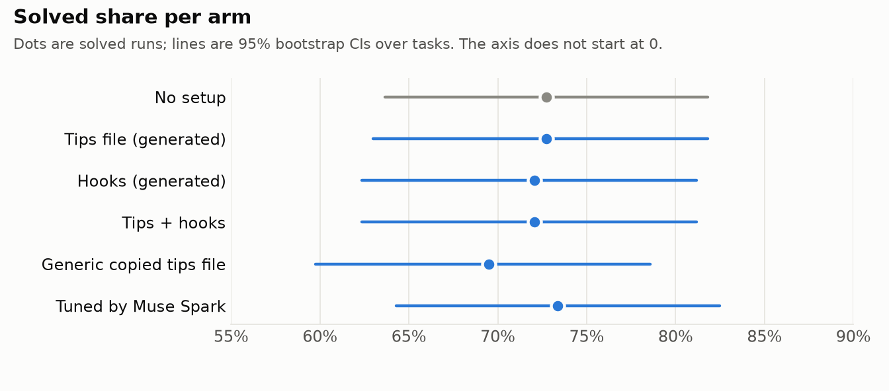
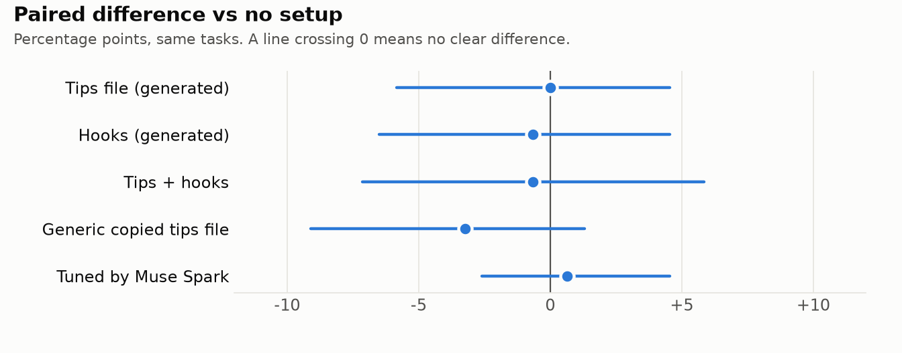
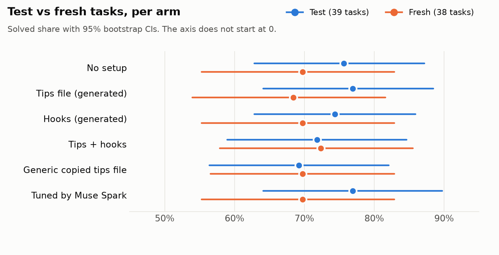
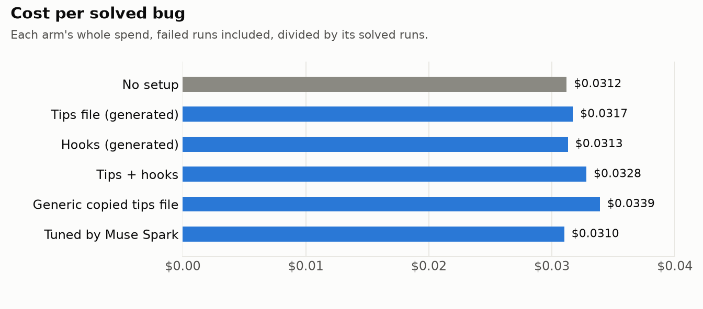

# Uplift main batch: does a coding-agent setup help on sqlglot's past bugs?

924 agent runs of Muse Code (muse-spark-1.3-contributor) on 77 screened sqlglot bugs (39 test + 38 fresh) × 6 arms × 2 repeats, graded by the repo's real tests. Total cost $21.31 from the proxy ledger ($0.023 per run).

**No arm's 95% interval excludes zero: no setup is shown to differ from none.** A difference this study could reliably see is about 5-9 points (80% power), so smaller real effects can't be ruled out.

**Read with care:** agents could reach the web, and some looked up the real fix. See [Web access](#web-access-a-leak-the-snapshot-checks-could-not-see).

## Solved per arm

| Arm | Solved | Rate | 95% CI | Runs at step limit | Regressions | Cost | Cost per solved |
| --- | --- | --- | --- | --- | --- | --- | --- |
| No setup | 112/154 | 72.7% | 63.6% to 81.8% | 0 | 0 | $3.50 | $0.0312 |
| Tips file (generated) | 112/154 | 72.7% | 63.0% to 81.8% | 0 | 0 | $3.55 | $0.0317 |
| Hooks (generated) | 111/154 | 72.1% | 62.3% to 81.2% | 5 | 0 | $3.48 | $0.0313 |
| Tips + hooks | 111/154 | 72.1% | 62.3% to 81.2% | 3 | 1 | $3.64 | $0.0328 |
| Generic copied tips file | 107/154 | 69.5% | 59.7% to 78.6% | 0 | 2 | $3.63 | $0.0339 |
| Tuned by Muse Spark | 113/154 | 73.4% | 64.3% to 82.5% | 3 | 0 | $3.51 | $0.0310 |

Intervals come from a task-level bootstrap (10,000 resamples, seed 20261101). Regressions are runs with any PASS_TO_PASS failure.

## Paired difference vs no setup

| Arm | Diff (points) | 95% CI | Tasks won | Tasks lost | CI half-width | Detectable at 80% power |
| --- | --- | --- | --- | --- | --- | --- |
| Tips file (generated) | +0.0 | -5.8 to +4.5 | 6 | 4 | ±5.2 | 7.4 |
| Hooks (generated) | -0.6 | -6.5 to +4.5 | 7 | 6 | ±5.5 | 8.0 |
| Tips + hooks | -0.6 | -7.1 to +5.8 | 6 | 7 | ±6.5 | 9.1 |
| Generic copied tips file | -3.2 | -9.1 to +1.3 | 4 | 7 | ±5.2 | 7.5 |
| Tuned by Muse Spark | +0.6 | -2.6 to +4.5 | 3 | 3 | ±3.6 | 5.4 |

Won or lost means the arm solved more or fewer of a task's repeats than no setup.

**Smallest effect we could detect.** The CI half-width (±3.6 to ±6.5 points) is the gap that would just reach significance, which a real effect of that size does only about half the time. For an 80% chance of detection the true gap has to be 5.4 to 9.1 points (2.8 × the bootstrap standard error). The 5 comparisons are not adjusted for multiplicity.

## Web access: a leak the snapshot checks could not see

Workspaces have no git history, but Muse Code has web tools and its shell has network access, so an agent can look up the real fix upstream. Nothing blocked this. `uplift web-audit` read every tool call in every trace: 80 of 924 runs (8.7%) reached the task's own fix or newer upstream code, and 78 of them solved it, against 572 of 821 (69.7%) of runs with docs or no web. That gap is partly easy tasks, so it doesn't measure how much the leak helped.

| Most the run reached | Runs | Solved |
| --- | --- | --- |
| The task's own fix diff | 59 | 57 |
| Newer upstream code | 21 | 21 |
| The task's own PR page | 7 | 6 |
| Another sqlglot PR or issue | 16 | 10 |
| Docs only, or no web | 821 | 572 |

- **By arm:** No setup 13, Tips file (generated) 12, Hooks (generated) 16, Tips + hooks 12, Generic copied tips file 15, Tuned by Muse Spark 12 exposed runs of 154 each. The spread is 2.6 points at most, so this is unlikely to explain the comparison, and the table below tests that.
- **By set:** test 73 of 468 runs, fresh 7 of 456. The older test tasks are far more exposed, which clouds the test vs fresh comparison.
- **Dev batch:** 69 of 304 runs exposed, so the tuned arm also learned from runs with this leak.
- **This is a lower bound:** URLs built at run time and search snippets are not detected.

**Does the result survive?** Difference vs no setup in points, with 95% CI:

| View | Tasks | Tips file (generated) | Hooks (generated) | Tips + hooks | Generic copied tips file | Tuned by Muse Spark |
| --- | --- | --- | --- | --- | --- | --- |
| All tasks | 77 | +0.0 (-5.8 to +4.5) | -0.6 (-6.5 to +4.5) | -0.6 (-7.1 to +5.8) | -3.2 (-9.1 to +1.3) | +0.6 (-2.6 to +4.5) |
| Without tasks where any run saw the fix or newer code | 51 | +0.0 (-5.9 to +4.9) | -1.0 (-6.9 to +4.9) | +1.0 (-5.9 to +7.8) | -2.9 (-8.8 to +2.0) | +0.0 (-3.9 to +3.9) |
| Also without tasks where any run saw its own PR page | 50 | +0.0 (-6.0 to +5.0) | -1.0 (-7.0 to +4.0) | +1.0 (-6.0 to +8.0) | -2.0 (-8.0 to +3.0) | +0.0 (-4.0 to +4.0) |
| All tasks, with every exposed run counted as failed | 77 | +0.6 (-5.8 to +6.5) | -1.9 (-8.4 to +3.9) | +0.0 (-6.5 to +6.5) | -3.9 (-11.0 to +3.2) | +1.3 (-3.2 to +5.8) |

## Which tasks can show a difference

- Solved in every run by every arm: 43 of 77.
- Never solved by any arm: 11 of 77.
- The other 23 are the only tasks that can separate arms.
- Repeat noise: the two repeats of one arm disagreed on 48 of 462 task-arm pairs, so the same setup often lands differently on the same task.

## Test vs fresh

| Arm | Test (39 tasks) | Fresh (38 tasks) |
| --- | --- | --- |
| No setup | 75.6% (62.8% to 87.2%) | 69.7% (55.3% to 82.9%) |
| Tips file (generated) | 76.9% (64.1% to 88.5%) | 68.4% (53.9% to 81.6%) |
| Hooks (generated) | 74.4% (62.8% to 85.9%) | 69.7% (55.3% to 82.9%) |
| Tips + hooks | 71.8% (59.0% to 84.6%) | 72.4% (57.9% to 85.5%) |
| Generic copied tips file | 69.2% (56.4% to 82.1%) | 69.7% (56.6% to 82.9%) |
| Tuned by Muse Spark | 76.9% (64.1% to 89.7%) | 69.7% (55.3% to 82.9%) |

## Cost per solved bug

Cost per solved is the arm's whole spend, failed runs included, divided by its solved runs. Differences between arms are small and have no interval, so read them as descriptive.

## Hook messages

| Arm | Runs with a message | Messages delivered | Fired too late to deliver |
| --- | --- | --- | --- |
| Tips + hooks | 91 | 120 | 3 |
| Hooks (generated) | 82 | 123 | 0 |
| Tuned by Muse Spark | 44 | 58 | 3 |

Delivered means the text is in a later model request, checked against each run's trace. A Stop block on the last step is logged by the hook but never reaches the agent.

## Why runs failed

258 of 258 failed runs have a label. Rules are checked facts and a run can match several. Muse Spark gives one label, from the issue, the real fix's file list and the agent's diff only.

**Rules, runs per arm**

| Arm | Failed | Edited none of the fix's files | Broke PASS_TO_PASS tests | Never ran tests | Hit the step limit |
| --- | --- | --- | --- | --- | --- |
| No setup | 42 | 1 | 0 | 5 | 0 |
| Tips file (generated) | 42 | 2 | 0 | 6 | 0 |
| Hooks (generated) | 43 | 3 | 0 | 7 | 5 |
| Tips + hooks | 43 | 1 | 1 | 10 | 3 |
| Generic copied tips file | 47 | 3 | 2 | 7 | 0 |
| Tuned by Muse Spark | 41 | 4 | 0 | 6 | 2 |

**Muse Spark labels, runs per arm**

| Arm | Wrong file | Incomplete fix | Wrong approach | Broke other tests | Ran out of steps | Other |
| --- | --- | --- | --- | --- | --- | --- |
| No setup | 1 | 19 | 4 | 17 | 1 | 0 |
| Tips file (generated) | 2 | 27 | 1 | 12 | 0 | 0 |
| Hooks (generated) | 2 | 30 | 2 | 8 | 1 | 0 |
| Tips + hooks | 1 | 29 | 2 | 11 | 0 | 0 |
| Generic copied tips file | 2 | 31 | 3 | 11 | 0 | 0 |
| Tuned by Muse Spark | 3 | 27 | 3 | 8 | 0 | 0 |

**Agreement with the rules**

| Rule | Label | Both | Rule only | Muse Spark only | Neither |
| --- | --- | --- | --- | --- | --- |
| Edited none of the fix's files | wrong file | 11 | 3 | 0 | 244 |
| Broke PASS_TO_PASS tests | broke other tests | 2 | 1 | 65 | 190 |
| Hit the step limit | ran out of steps | 0 | 10 | 2 | 246 |

Muse Spark sees no test results or step count, so the last two rows test it on what it had to guess. Its "broke other tests" label is not reliable: 65 of its 67 uses are on runs where every PASS_TO_PASS test passed. Its reasons often cite files in the real fix that the agent left alone, so "incomplete fix" may be over-counted too. Treat the labels as a rough view of the failures and the rules as the facts. "Never ran tests" has no matching label.

## Dev ablation (hooks one at a time)

Dev tasks only, screened, one repeat per task, so this is what shaped the tuned arm and not a final result.

| Arm | Solved | Wins vs none | Losses vs none |
| --- | --- | --- | --- |
| none | 26/37 | 0 | 0 |
| lint-only | 27/37 | 2 | 1 |
| cochange-only | 21/37 | 1 | 6 |
| verify-only | 28/37 | 4 | 2 |

## Limitations

- One repo (sqlglot) and one agent (Muse Code on muse-spark-1.3-contributor).
- 40-step agent budget for every arm (Muse wind-down starts at step 30); the verify hook arrives late in that budget.
- "Seeds" are repeats: the seed labels the run but isn't passed to Muse.
- Screening rule fixed before seeing results, no overrides: task 4516 was probably dropped wrongly and stays dropped.
- Ceiling effect: 43/77 tasks solved by every run of every arm, 11 by none; only ~23 tasks can show a difference.
- The tuned arm was chosen from one-seed dev differences: a hypothesis, not a proven improvement.
- Agents had web and shell network access: at least 80 of 924 runs reached the real fix or newer upstream code, 12-16 per arm and mostly on test tasks. Removing them doesn't change the conclusion, but solve rates are somewhat inflated, and test vs fresh is not a clean comparison.
- The 5 comparisons vs none are not adjusted for multiplicity, and the intervals move by up to one step (0.65 points) with the bootstrap seed.
- 6 verify blocks fired on the last step and never reached the agent.
- Global gitignore on the build machine keeps a few agent files (CLAUDE.md, .claude/, .cursor/) out of start commits; grading is unaffected.
